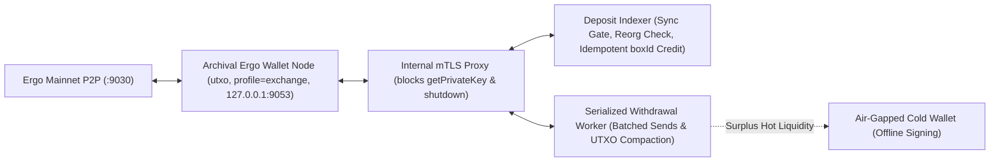

# Ergo Wallet REST API and Exchange Integration Guide

This guide provides a complete, source-verified reference for operating the Ergo reference node's built-in HD wallet REST API (`/wallet/*`), external blockchain scans (`/scan/*`), mining reward withdrawals (`/mining/*`), and a production **Exchange & Custodian Integration Architecture** for `ERG` and native Ergo tokens.

All endpoint paths, HTTP methods, configuration keys, JSON request/response schemas, and behavioral edge cases documented here are verified directly against the Ergo reference client (`v6.0`).

---

## Table of Contents

1. [Overview & Protocol Fundamentals](#1-overview--protocol-fundamentals)
   - [Extended UTXO (eUTXO) Box Model](#11-extended-utxo-eutxo-box-model)
   - [Units, Precision, Minimum Box Value & Storage Rent](#12-units-precision-minimum-box-value--storage-rent)
   - [Address Formats & Network Prefixes](#13-address-formats--network-prefixes)
   - [REST API Conventions, Authentication & Error Format](#14-rest-api-conventions-authentication--error-format)
2. [Production Node Configuration & Security Hardening](#2-production-node-configuration--security-hardening)
   - [Mandatory Node Settings for Wallet & Exchange Workloads](#21-mandatory-node-settings-for-wallet--exchange-workloads)
   - [Wallet Scaling Profiles (`ergo.wallet.profile`)](#22-wallet-scaling-profiles-ergowalletprofile)
   - [Generating `apiKeyHash`](#23-generating-apikeyhash)
   - [Production `ergo.conf` Reference Template](#24-production-ergoconf-reference-template)
   - [Network Isolation & Reverse Proxy Hardening](#25-network-isolation--reverse-proxy-hardening)
3. [Wallet Lifecycle & Key Management](#3-wallet-lifecycle--key-management)
   - [Wallet State Machine](#31-wallet-state-machine)
   - [Initialize a New Wallet (`POST /wallet/init`)](#32-initialize-a-new-wallet-post-walletinit)
   - [Restore an Existing Wallet (`POST /wallet/restore`)](#33-restore-an-existing-wallet-post-walletrestore)
   - [Verify Mnemonic Seed (`POST /wallet/check`)](#34-verify-mnemonic-seed-post-walletcheck)
   - [Unlock & Lock Wallet (`POST /wallet/unlock`, `GET /wallet/lock`)](#35-unlock--lock-wallet-post-walletunlock-get-walletlock)
   - [Check Wallet Status (`GET /wallet/status`)](#36-check-wallet-status-get-walletstatus)
   - [Update Change Address (`POST /wallet/updateChangeAddress`)](#37-update-change-address-post-walletupdatechangeaddress)
   - [Rescan Blockchain (`POST /wallet/rescan`)](#38-rescan-blockchain-post-walletrescan)
   - [Export Private Key (`POST /wallet/getPrivateKey`)](#39-export-private-key-post-walletgetprivatekey)
   - [Re-Initializing or Replacing an Existing Wallet](#310-re-initializing-or-replacing-an-existing-wallet)
4. [Address Derivation & Validation](#4-address-derivation--validation)
   - [EIP-3 Hierarchical Deterministic Key Derivation](#41-eip-3-hierarchical-deterministic-key-derivation)
   - [List Wallet Addresses (`GET /wallet/addresses`)](#42-list-wallet-addresses-get-walletaddresses)
   - [Derive Next Sequential Key (`GET /wallet/deriveNextKey`)](#43-derive-next-sequential-key-get-walletderivenextkey)
   - [Derive Specific Path (`POST /wallet/deriveKey`)](#44-derive-specific-path-post-walletderivekey)
   - [Address Validation & Conversion Utilities (`/utils/*`)](#45-address-validation--conversion-utilities-utils)
5. [Balances, UTXO Boxes, Transactions & External Scans](#5-balances-utxo-boxes-transactions--external-scans)
   - [Query Balances (`GET /wallet/balances`, `GET /wallet/balances/withUnconfirmed`)](#51-query-balances-get-walletbalances-get-walletbalanceswithunconfirmed)
   - [Query Wallet Boxes (`GET /wallet/boxes/unspent`, `GET /wallet/boxes`)](#52-query-wallet-boxes-get-walletboxesunspent-get-walletboxes)
   - [Collect Boxes for Target Amount (`POST /wallet/boxes/collect`)](#53-collect-boxes-for-target-amount-post-walletboxescollect)
   - [Query Wallet Transactions (`/wallet/transactions*`)](#54-query-wallet-transactions-wallettransactions)
   - [External Application Scans API (`/scan/*` — EIP-1 / EIP-19)](#55-external-application-scans-api-scan--eip-1--eip-19)
6. [Transaction Construction, Signing, Multi-Sig & Broadcasting](#6-transaction-construction-signing-multi-sig--broadcasting)
   - [Simple & Batched Payments (`POST /wallet/payment/send`)](#61-simple--batched-payments-post-walletpaymentsend)
   - [Advanced Transaction Requests (`RequestsHolder`)](#62-advanced-transaction-requests-requestsholder)
   - [Native Token Transfers, Issuance & Burning](#63-native-token-transfers-issuance--burning)
   - [Air-Gapped Offline / Cold-Wallet Signing Workflow](#64-air-gapped-offline--cold-wallet-signing-workflow)
   - [Multi-Signature & Threshold Signing (EIP-11)](#65-multi-signature--threshold-signing-eip-11)
   - [Fee Estimation, Validation & Mempool Inspection (`/transactions/*`)](#66-fee-estimation-validation--mempool-inspection-transactions)
7. [Mining Reward Withdrawal Guide](#7-mining-reward-withdrawal-guide)
   - [Protocol Mechanics of Mined Rewards (720-Block Timelock)](#71-protocol-mechanics-of-mined-rewards-720-block-timelock)
   - [Inspecting Miner Reward Address & Pending Rewards](#72-inspecting-miner-reward-address--pending-rewards)
   - [Withdrawing Matured Mining Rewards](#73-withdrawing-matured-mining-rewards)
   - [Exchange Policy: Mining Pool Payouts vs. Solo Mining Rewards](#74-exchange-policy-mining-pool-payouts-vs-solo-mining-rewards)
8. [Exchange Integration Reference Architecture](#8-exchange-integration-reference-architecture)
   - [System Topology & Hot / Cold Wallet Tiering](#81-system-topology--hot--cold-wallet-tiering)
   - [Node & Wallet Sync Readiness Gate](#82-node--wallet-sync-readiness-gate)
   - [Deposit Tracking Strategies (Per-User EIP-3 vs. Register Tags)](#83-deposit-tracking-strategies-per-user-eip-3-vs-register-tags)
   - [Confirmation Counting (`0`-Indexed `confirmationsNum`) & Thresholds](#84-confirmation-counting-0-indexed-confirmationsnum--thresholds)
   - [Idempotent Deposit Crediting & Native Token Verification](#85-idempotent-deposit-crediting--native-token-verification)
   - [Chain Reorganization (Rollback) Detection & Reconciliation](#86-chain-reorganization-rollback-detection--reconciliation)
   - [Withdrawal Batching, Concurrency Control & UTXO Management](#87-withdrawal-batching-concurrency-control--utxo-management)
   - [Reference Integration Pseudocode](#88-reference-integration-pseudocode)
9. [Complete Endpoint Quick Reference](#9-complete-endpoint-quick-reference)

---

## 1. Overview & Protocol Fundamentals

### 1.1 Extended UTXO (eUTXO) Box Model

Ergo uses an **Extended UTXO (eUTXO)** ledger model rather than an account-balance model. Every unspent output is an immutable **Box** (`ErgoBox`) containing:

| Register / Field | Name in JSON | Description |
| :--- | :--- | :--- |
| `boxId` | `boxId` | Globally unique 32-byte (64-hex-char) Blake2b-256 identifier derived deterministically from the creating transaction's inputs and the output index. **A `boxId` can never collide or repeat across the entire history of the blockchain.** |
| `R0` | `value` | Amount of native `ERG` locked in the box, denominated in **nanoERG** (`Long`, 64-bit signed integer). |
| `R1` | `ergoTree` | Hex-encoded serialized Sigma/ErgoScript guarding proposition (`ErgoTree`) that must evaluate to `true` to spend the box. |
| `R2` | `assets` | Up to 255 native tokens stored directly inside the box as `[{"tokenId": "<64-hex>", "amount": <Long>}]`. Every box holding tokens must also hold at least the minimum protocol `ERG` value. |
| `R3` | `creationHeight`, `transactionId`, `index` | Creation metadata: block height specified by the transaction creator, creating transaction ID, and 0-based output index. |
| `R4`–`R9` | `additionalRegisters` | Six optional typed registers storing Sigma-serialized constants (e.g., byte arrays/memos, integers, group elements, token metadata). |

### 1.2 Units, Precision, Minimum Box Value & Storage Rent

- **Atomic Unit (`nanoERG`)**: All REST API requests and responses represent `ERG` amounts as integer **nanoERGs**:
  $$1\text{ ERG} = 10^9\text{ nanoERG} = 1,000,000,000\text{ nanoERG}$$
  Never use IEEE-754 floating-point numbers (`double` / JS `number` arithmetic on decimals) when accounting for `ERG` or token balances; always store and compute values as 64-bit integers (`int64` / `BigInt`).
- **Minimum Box Value (Dust Prevention)**: Consensus rules reject any output whose `value` is smaller than:
  $$\text{minBoxValue} = \text{serializedBoxSizeBytes} \times \text{minValuePerByte}$$
  On mainnet, `minValuePerByte` defaults to `360` nanoERG/byte (query dynamically via `GET /info` -> `parameters.minValuePerByte`). A plain P2PK box without tokens is ~100–110 bytes (~`39,600` nanoERG minimum), while boxes carrying multiple tokens or `R4`–`R9` registers require correspondingly more nanoERGs. **Recommended operational floor**: enforce a minimum withdrawal/output amount of at least `1,000,000` nanoERG (`0.001 ERG`).
- **Default Miner Fee**: `1,000,000` nanoERG (`0.001 ERG`) for standard P2PK transactions (`ergo.wallet.defaultTransactionFee`). During congestion, query `GET /transactions/getFee` for dynamic fee sizing.
- **Storage Rent (Demurrage)**: Any box that remains unspent for **4 years** (`1,051,200` blocks) can have storage rent (`serializedBoxSizeBytes * parameters.storageFeeFactor`, currently `1,250,000` nanoERG/byte) collected by miners. Exchanges should periodically consolidate old, small UTXOs so long-dormant dust boxes are not depleted by storage rent.

### 1.3 Address Formats & Network Prefixes

Ergo addresses are Base58Check-encoded strings (using Blake2b-256 4-byte checksums) whose first byte encodes `(networkPrefix | addressType)`:

| Network | Prefix Byte | P2PK (`0x01`) | P2SH (`0x02`) | P2S (`0x03`) | Default REST Port | Default P2P Port |
| :--- | :--- | :--- | :--- | :--- | :--- | :--- |
| **Mainnet** | `0x00` (`0`) | Starts with **`9`** (51 chars) | Starts with **`8`** | Variable length | `9053` | `9030` |
| **Testnet** | `0x10` (`16`) | Starts with **`3W`** | Starts with **`2`** | Variable length | `9052` | `9020` |

- **P2PK (Pay-to-Public-Key)**: Standard wallet and user deposit address encoding a compressed secp256k1 `ProveDlog` public key (`ergoTree` = `0008cd` + 33-byte compressed public key).
- **P2S (Pay-to-Script)** / **P2SH (Pay-to-Script-Hash)**: Smart-contract addresses (such as timelocked miner reward scripts). Exchanges should allow withdrawals to valid P2PK, P2SH, and P2S addresses validated via `GET /utils/address/{address}` (note that P2S addresses have no fixed character length because they serialize the full `ErgoTree`).

### 1.4 REST API Conventions, Authentication & Error Format

- **Interactive OpenAPI / Swagger UI**: Every running node serves Swagger UI at `http://<host>:<port>/swagger` and its OpenAPI specification in `src/main/resources/api/openapi.yaml`. *(Where `openapi.yaml` differs from the actual Circe JSON codecs in `v6.0`, this guide explicitly calls out the authoritative runtime behavior.)*
- **Authentication (`api_key` Header)**: All `/wallet/*`, `/scan/*`, `POST /blocks`, and `/node/shutdown` endpoints require the HTTP header:
  ```http
  api_key: <your-plaintext-api-secret>
  ```
  The node hashes the header value with Blake2b-256 and compares it against `scorex.restApi.apiKeyHash` in `ergo.conf`. Missing or mismatched keys return `403 Forbidden`.
- **Content-Type & Entity Timeout**: All `POST` bodies use `Content-Type: application/json`. All `/wallet/*` routes enforce a strict `30`-second request payload read timeout (`toStrictEntity(30.seconds)`).
- **Standard Error Envelope**: Errors return JSON in the format:
  ```json
  {
    "error": 400,
    "reason": "bad.request",
    "detail": "Wallet is locked"
  }
  ```

---

## 2. Production Node Configuration & Security Hardening

### 2.1 Mandatory Node Settings for Wallet & Exchange Workloads

1. **Full UTXO State (`ergo.node.stateType = "utxo"`)**: Wallet signing, input resolution, and mempool transaction verification require `"utxo"` state. Stateless `"digest"` nodes cannot maintain or operate a local wallet.
2. **Archival Full Blocks (`ergo.node.blocksToKeep = -1`)**: Do **not** enable block pruning (`blocksToKeep >= 0`) on a wallet node. If historical full blocks are pruned (`isFullBlocksPruned == true`), `POST /wallet/restore` fails immediately with `"Unable to restore wallet when pruning is enabled"`, and `POST /wallet/rescan` cannot scan historical heights prior to the pruned suffix. *(Fast initial sync via `ergo.node.utxo.utxoBootstrap = true` is supported only if the wallet's keys have zero historical transactions prior to the snapshot height; for full historical recovery capability, sync with `blocksToKeep = -1` and `utxoBootstrap = false`.)*
3. **Disable Mining (`ergo.node.mining = false`)**: Dedicated exchange wallet nodes must never mine blocks.
4. **Rollback Window (`ergo.node.keepVersions = 200`)**: Retains 200 state versions so the node can cleanly roll back and re-apply UTXO and wallet registry state across chain reorganizations up to 200 blocks deep.

### 2.2 Wallet Scaling Profiles (`ergo.wallet.profile`)

The wallet uses in-memory Bloom filters (`WalletProfile.scala`) during block scanning to test whether transaction inputs spend tracked boxes or match tracked scripts. Choosing `"exchange"` prevents Bloom filter saturation and false-positive disk lookups as user address counts and UTXO volume grow:

| `ergo.wallet.profile` | Scripts Bloom Capacity | Unspent Boxes Bloom Capacity | Approx. Filter RAM | Target Workload |
| :--- | :--- | :--- | :--- | :--- |
| `"user"` *(default)* | `1,000` | `10,000` | ~0.2 MB | Personal desktop / CLI wallet |
| `"appServer"` | `50,000` | `2,000,000` | ~4 MB | dApp backend / payment gateway |
| `"exchange"` | `1,000,000` | `10,000,000` | ~20 MB | **Cryptocurrency exchanges & custodians** |

### 2.3 Generating `apiKeyHash`

Generate a cryptographically random secret (e.g. `openssl rand -hex 32`) and compute its **Blake2b-256** hex digest.

> **Security Warning**: Mainnet's bundled `mainnet.conf` ships with a default `apiKeyHash` (`324dcf027dd4a30a932c441f365a25e86b173defa4b8e58948253471b81b72cf`, which corresponds to the plaintext `"hello"`) and binds `0.0.0.0:9053`. **Never start a mainnet wallet node without overriding both `bindAddress` and `apiKeyHash`.**

Using a locally bound node's utility endpoint (note that the body is a JSON string, so quotes around the secret are required):

```bash
curl -s -X POST "http://127.0.0.1:9053/utils/hash/blake2b" \
  -H "Content-Type: application/json" \
  -d '"replace-with-64-char-random-secret"'
```

Response:

```json
"7b6d8a2e0f3e19c8e1440d445f8c30b14d9f1a6a9b235f87c1e2a3b4c5d6e7f8"
```

*(You can also compute Blake2b-256 completely offline with `b2sum -l 256` on Linux or `hashlib.blake2b(b"secret", digest_size=32).hexdigest()` in Python, ensuring no trailing newline is hashed.)*

### 2.4 Production `ergo.conf` Reference Template

Run the node with `java -Xmx8G -jar ergo.jar --mainnet -c ergo.conf`:

```hocon
ergo {
  directory = "/var/lib/ergo/.ergo"

  node {
    stateType = "utxo"
    blocksToKeep = -1          # Keep all full blocks; required for /wallet/restore and full /wallet/rescan
    keepVersions = 200         # Max rollback depth (blocks)
    mining = false
    utxo.utxoBootstrap = false # Full archival verification from genesis
    extraIndex = false         # Explorer index (/blockchain/*) is NOT required for /wallet/* or /scan/*
  }

  wallet {
    profile = "exchange"       # Sizes Bloom filters for 1M scripts / 10M UTXOs (~20 MB RAM)
    seedStrengthBits = 256     # 24-word BIP-39 mnemonic on /wallet/init (options: 128, 160, 192, 224, 256)
    mnemonicPhraseLanguage = "english"
    usePreEip3Derivation = false

    # Retain spent boxes in wallet storage if you audit historical inputs via /wallet/boxes or /scan/spentBoxes
    keepSpentBoxes = true

    # Default miner fee automatically attached by POST /wallet/payment/send (0.001 ERG)
    defaultTransactionFee = 1000000

    # Ignore incoming dust boxes below this nanoERG threshold during block scan (mitigates UTXO dust attacks)
    dustLimit = 100000

    # Box selector limits (ReplaceCompactCollectBoxSelector)
    maxInputs = 100            # Hard cap on inputs selected per transaction
    optimalInputs = 3          # Target input count to passively compact fragmented UTXOs

    # CRITICAL WARNING: Leave tokensWhitelist commented out (null) to preserve ALL tokens!
    # Setting tokensWhitelist = [] causes the wallet to BURN all unlisted tokens in selected inputs!
    # tokensWhitelist = null

    secretStorage {
      secretDir = ${ergo.directory}"/wallet/keystore"
      encryption {
        prf = "HmacSHA256"
        c = 128000
        dkLen = 256            # AES-256 (requires modern JDK 8u161+ / JDK 11 / JDK 17 / JDK 21)
      }
    }
  }
}

scorex {
  network {
    bindAddress = "0.0.0.0:9030"
    nodeName = "exchange-ergo-wallet-01"
  }

  restApi {
    # NEVER expose 9053 on 0.0.0.0; bind strictly to loopback and front with mTLS reverse proxy if remote access is needed
    bindAddress = "127.0.0.1:9053"
    apiKeyHash = "<64-HEX-CHAR-BLAKE2B-256-HASH>"
    corsAllowedOrigin = null
  }
}
```

> **Critical `tokensWhitelist` Warning**:
> - When `tokensWhitelist` is omitted or `null` *(default)*, the wallet preserves and tracks **all** native tokens.
> - When `tokensWhitelist = ["<tokenId1>", "<tokenId2>"]` (or `[]`), **any token not in the list present inside an input selected for a transaction is intentionally omitted from change outputs and permanently burned on-chain** (`ErgoWalletSupport.prepareRequests`). Exchanges listing or custodying arbitrary user tokens must leave `tokensWhitelist = null`.

### 2.5 Network Isolation & Reverse Proxy Hardening

Even with `apiKeyHash` configured, the node's built-in HTTP server uses plaintext HTTP. In production:
1. Bind `scorex.restApi.bindAddress = "127.0.0.1:9053"`.
2. Place an mTLS-authenticated reverse proxy (NGINX / Envoy) in front of `127.0.0.1:9053` for internal wallet microservices.
3. **Explicitly block** `POST /wallet/getPrivateKey`, `POST /node/shutdown`, and `/swagger` at the proxy layer so a compromised application service cannot exfiltrate raw private scalars or halt the node:

```nginx
location ~ ^/(wallet/getPrivateKey|node/shutdown|swagger) {
    deny all;
    return 403;
}

location / {
    proxy_pass http://127.0.0.1:9053;
    proxy_read_timeout 60s;
}
```

---

## 3. Wallet Lifecycle & Key Management

### 3.1 Wallet State Machine

```mermaid
stateDiagram-v2
    [*] --> Uninitialized: Fresh node (no keystore file)
    Uninitialized --> Unlocked: POST /wallet/init (auto-unlocks + derives m/44'/429'/0'/0/0)
    Uninitialized --> Locked: POST /wallet/restore (creates keystore; remains locked)
    Locked --> Unlocked: POST /wallet/unlock
    Unlocked --> Locked: GET /wallet/lock (or node restart)
```



- **Background Scanning While Locked**: Once derived, public keys are cached in persistent `WalletStorage`. Even when the wallet is **locked** (`isUnlocked: false`), the node continues scanning incoming blocks and mempool transactions, updating `GET /wallet/balances`, `GET /wallet/boxes/*`, and `GET /wallet/transactions*`.
- **Operations Requiring Unlocked State**: Key derivation (`deriveKey`, `deriveNextKey`), `updateChangeAddress`, `getPrivateKey`, automatic input selection in `generate`/`generateUnsigned`, `sign`, `payment/send`, `transaction/send`, and `generateCommitments`.

### 3.2 Initialize a New Wallet (`POST /wallet/init`)

Generates a fresh BIP-39 mnemonic phrase of strength `ergo.wallet.seedStrengthBits`, encrypts the seed into `${ergo.wallet.secretStorage.secretDir}`, **automatically unlocks** the wallet, derives the first EIP-3 address (`m/44'/429'/0'/0/0`), and sets it as `changeAddress`.

- **`pass`**: Encryption password for the on-disk JSON keystore file (used later in `POST /wallet/unlock`).
- **`mnemonicPass`** *(optional)*: BIP-39 passphrase ("25th word") mixed into PBKDF2 seed derivation. **If set, both the mnemonic words AND `mnemonicPass` are permanently required to restore the wallet; losing either makes funds unrecoverable.**

```bash
curl -s -X POST "http://127.0.0.1:9053/wallet/init" \
  -H "Content-Type: application/json" \
  -H "api_key: $ERGO_API_KEY" \
  -d '{
    "pass": "strong-keystore-encryption-password",
    "mnemonicPass": ""
  }'
```

Response (`200 OK`):

```json
{
  "mnemonic": "slow silly start wash bundle suffer bulb ancient height spin express remind today effort helmet"
}
```

*(Fails with `400 Bad Request` `"Wallet is already initialized or testMnemonic is set. Clear current secret to re-init it."` if a keystore file already exists.)*

### 3.3 Restore an Existing Wallet (`POST /wallet/restore`)

Creates the encrypted keystore from an existing BIP-39 mnemonic. After `restore`, the wallet starts in the **locked** state (`isUnlocked: false`).

- **`usePre1627KeyDerivation`** *(boolean, **REQUIRED**)*: Must always be supplied in the JSON payload (omitting it fails request decoding).
  - Set `false` for all standard EIP-3 / modern Ergo wallets (`v4.0.105+` and `v5.x` / `v6.x`).
  - Set `true` **only** when migrating a legacy node wallet created prior to `ergoplatform/ergo#1627` that suffered from non-standard 31-byte BigInteger sign-bit key derivation.

```bash
curl -s -X POST "http://127.0.0.1:9053/wallet/restore" \
  -H "Content-Type: application/json" \
  -H "api_key: $ERGO_API_KEY" \
  -d '{
    "pass": "strong-keystore-encryption-password",
    "mnemonic": "slow silly start wash bundle suffer bulb ancient height spin express remind today effort helmet",
    "mnemonicPass": "",
    "usePre1627KeyDerivation": false
  }'
```

Response (`200 OK`):

```json
{}
```

> **Critical Operational Sequence for Wallet Recovery**:
> `WalletScanLogic` only indexes boxes matching public keys currently tracked in `WalletStorage`. `POST /wallet/restore` derives only the master/initial key (`m/44'/429'/0'/0/0`). To recover historical balances across `N` previously generated user deposit addresses:
> 1. Call `POST /wallet/restore` (`usePre1627KeyDerivation: false`).
> 2. Call `POST /wallet/unlock` with `"pass"`.
> 3. Re-derive all previously issued child keys (`GET /wallet/deriveNextKey` `N` times, or `POST /wallet/deriveKey` for each path).
> 4. Call `POST /wallet/rescan` with `{"fromHeight": 0}` and wait until `walletHeight == fullHeight` in `GET /wallet/status`.

### 3.4 Verify Mnemonic Seed (`POST /wallet/check`)

Verifies whether a given mnemonic and optional `mnemonicPass` match the encrypted on-disk keystore without modifying wallet state.

```bash
curl -s -X POST "http://127.0.0.1:9053/wallet/check" \
  -H "Content-Type: application/json" \
  -H "api_key: $ERGO_API_KEY" \
  -d '{
    "mnemonic": "slow silly start wash bundle suffer bulb ancient height spin express remind today effort helmet",
    "mnemonicPass": ""
  }'
```

Response (`200 OK`):

```json
{
  "matched": true
}
```

### 3.5 Unlock & Lock Wallet (`POST /wallet/unlock`, `GET /wallet/lock`)

#### Unlock (`POST /wallet/unlock`)

Decrypts the master secret into memory and initializes the Sigma `ErgoProvingInterpreter`:

```bash
curl -s -X POST "http://127.0.0.1:9053/wallet/unlock" \
  -H "Content-Type: application/json" \
  -H "api_key: $ERGO_API_KEY" \
  -d '{
    "pass": "strong-keystore-encryption-password"
  }'
```

Response (`200 OK`): `{}` *(Returns `400 Bad Request` `"Wallet already unlocked"` if already unlocked, or `"File does not exist"` / decryption error if uninitialized or wrong password. If an outdated JVM throws `"Key of length 256 is not allowed on your JVM version"`, upgrade to a modern JDK 11/17/21 with unlimited JCE crypto policy.)*

#### Lock (`GET /wallet/lock`)

> **HTTP Method Note**: `/wallet/lock` is an HTTP **`GET`** endpoint (not `POST`).

Purges the decrypted root secret and prover from memory:

```bash
curl -s -X GET "http://127.0.0.1:9053/wallet/lock" \
  -H "api_key: $ERGO_API_KEY"
```

Response (`200 OK`): `{}`

### 3.6 Check Wallet Status (`GET /wallet/status`)

Returns initialization state, lock state, active change address, last scanned block height, and any active rescan/wallet error message:

```bash
curl -s -X GET "http://127.0.0.1:9053/wallet/status" \
  -H "api_key: $ERGO_API_KEY"
```

Response (`200 OK`):

```json
{
  "isInitialized": true,
  "isUnlocked": true,
  "changeAddress": "9fRusAarL1KkrWQVsxSRVYnvWxaAT2A96cKtNn9tvPh5XUyCisr",
  "walletHeight": 1385420,
  "error": ""
}
```

### 3.7 Update Change Address (`POST /wallet/updateChangeAddress`)

Sets the destination address for excess `ERG` and tokens returned as change in wallet-generated transactions.

- **Constraints**: The wallet **must be unlocked**, and `address` **must be a valid P2PK address already derived and owned by this wallet** (`state.walletVars.trackedPubKeys` check; external addresses return `400 Bad Request` `"Address is not owned by wallet"`).

```bash
curl -s -X POST "http://127.0.0.1:9053/wallet/updateChangeAddress" \
  -H "Content-Type: application/json" \
  -H "api_key: $ERGO_API_KEY" \
  -d '{
    "address": "9fRusAarL1KkrWQVsxSRVYnvWxaAT2A96cKtNn9tvPh5XUyCisr"
  }'
```

Response (`200 OK`): `{}`

### 3.8 Rescan Blockchain (`POST /wallet/rescan`)

Wipes and rebuilds the `WalletRegistry` by asynchronously rescanning local full blocks from `fromHeight` (defaults to `0` if body is empty) up to `fullHeight`. Does **not** require the wallet to be unlocked (scans using persisted public keys and registered `/scan/*` rules).

```bash
curl -s -X POST "http://127.0.0.1:9053/wallet/rescan" \
  -H "Content-Type: application/json" \
  -H "api_key: $ERGO_API_KEY" \
  -d '{
    "fromHeight": 1200000
  }'
```

Response (`200 OK`): `{}` *(Returns `400 Bad Request` `"Rescan already in progress"` if another rescan is currently running. Poll `GET /wallet/status` until `walletHeight` catches up to `GET /info` -> `fullHeight`.)*

### 3.9 Export Private Key (`POST /wallet/getPrivateKey`)

Returns the hex-encoded 32-byte secp256k1 scalar (`DlogSecretKey`) corresponding to a derived P2PK wallet address. Requires the wallet to be **unlocked**.

```bash
curl -s -X POST "http://127.0.0.1:9053/wallet/getPrivateKey" \
  -H "Content-Type: application/json" \
  -H "api_key: $ERGO_API_KEY" \
  -d '{
    "address": "9fRusAarL1KkrWQVsxSRVYnvWxaAT2A96cKtNn9tvPh5XUyCisr"
  }'
```

Response (`200 OK`):

```json
"3e9b1d4a7c2f8015b6d8e3f21a4c90b7e6d5c4b3a291807f6e5d4c3b2a190807"
```

### 3.10 Re-Initializing or Replacing an Existing Wallet

There is **no** `/wallet/reinit` HTTP endpoint. Calling `POST /wallet/init` or `POST /wallet/restore` on an already initialized node returns `400 Bad Request` to prevent accidental seed destruction. To replace a wallet safely:

1. Back up the existing mnemonic and stop the Ergo node process cleanly.
2. Move (do not delete until verified) the keystore directory `${ergo.wallet.secretStorage.secretDir}` (default `${ergo.directory}/wallet/keystore`) to secure offline backup storage.
3. Start the Ergo node.
4. Call `POST /wallet/init` or `POST /wallet/restore` — both endpoints automatically wipe and recreate `${ergo.directory}/wallet/registry` and `${ergo.directory}/wallet/storage` so stale addresses and UTXOs from the previous seed do not leak into the new wallet.

---

## 4. Address Derivation & Validation

### 4.1 EIP-3 Hierarchical Deterministic Key Derivation

Ergo follows **EIP-0003** (BIP-44 coin type **`429`** for Ergo):

```text
m / 44' / 429' / account' / 0 / address_index
```

- First address automatically derived at initialization: `m/44'/429'/0'/0/0`.
- Subsequent calls to `GET /wallet/deriveNextKey` increment the final non-hardened index sequentially: `m/44'/429'/0'/0/1`, `m/44'/429'/0'/0/2`, ...
- Derivation paths passed to `POST /wallet/deriveKey` **must begin with lowercase `m/`** (private derivation path). Passing uppercase `M/` fails with `"A private path is expected, but the public one given"`.

### 4.2 List Wallet Addresses (`GET /wallet/addresses`)

Returns all P2PK addresses currently derived and tracked by the wallet (works while locked or unlocked):

```bash
curl -s -X GET "http://127.0.0.1:9053/wallet/addresses" \
  -H "api_key: $ERGO_API_KEY"
```

Response (`200 OK`):

```json
[
  "9fRusAarL1KkrWQVsxSRVYnvWxaAT2A96cKtNn9tvPh5XUyCisr",
  "9g1p6UU8XoAeU4yH6G8oV4JqK9pZ2mN7xL5vR3tW1yQ8sD4fH6j"
]
```

### 4.3 Derive Next Sequential Key (`GET /wallet/deriveNextKey`)

> **HTTP Method Note**: `/wallet/deriveNextKey` is an HTTP **`GET`** endpoint that mutates wallet state by persisting the newly derived EIP-3 public key. The wallet **must be unlocked**.

```bash
curl -s -X GET "http://127.0.0.1:9053/wallet/deriveNextKey" \
  -H "api_key: $ERGO_API_KEY"
```

Response (`200 OK`):

```json
{
  "derivationPath": "m/44'/429'/0'/0/1",
  "address": "9g1p6UU8XoAeU4yH6G8oV4JqK9pZ2mN7xL5vR3tW1yQ8sD4fH6j"
}
```

### 4.4 Derive Specific Path (`POST /wallet/deriveKey`)

Derives and persists a specific BIP-32/EIP-3 path (wallet **must be unlocked**). Calling `deriveKey` on an already-derived path is idempotent and returns its address.

```bash
curl -s -X POST "http://127.0.0.1:9053/wallet/deriveKey" \
  -H "Content-Type: application/json" \
  -H "api_key: $ERGO_API_KEY" \
  -d '{
    "derivationPath": "m/44'\''/429'\''/0'\''/0/42"
  }'
```

Response (`200 OK`):

```json
{
  "address": "9h7kL2mN9pQ4rS6tV8wX1yZ3aB5cD7eF9gH2jK4mN6pQ8rS1tV3"
}
```

### 4.5 Address Validation & Conversion Utilities (`/utils/*`)

`/utils/*` endpoints do **not** require `api_key` authentication and do **not** require an unlocked wallet. Always validate user-supplied withdrawal addresses against the node's configured network (mainnet vs. testnet checksum & prefix validation):

#### Validate Address (`POST /utils/address` or `GET /utils/address/{address}`)

Prefer `POST /utils/address` for long P2S contract addresses to avoid URL path length limits:

```bash
curl -s -X POST "http://127.0.0.1:9053/utils/address" \
  -H "Content-Type: application/json" \
  -d '"9fRusAarL1KkrWQVsxSRVYnvWxaAT2A96cKtNn9tvPh5XUyCisr"'
```

Valid response (`200 OK`):

```json
{
  "address": "9fRusAarL1KkrWQVsxSRVYnvWxaAT2A96cKtNn9tvPh5XUyCisr",
  "isValid": true
}
```

Invalid / wrong-network response (`200 OK` with `"isValid": false` and `"error"`):

```json
{
  "error": "Trying to decode testnet address in mainnet",
  "address": "3WwbzW6u8hKWBcL1W7kNVMr25s2UHfSBnYtwSHvrRQt7DdPuoXrt",
  "isValid": false
}
```

#### Convert Between Address, Raw Public Key, and `ErgoTree`

- `GET /utils/addressToRaw/{address}` -> `{"raw": "035a29..."}` (extracts 33-byte compressed secp256k1 public key hex from P2PK, or content bytes from P2SH/P2S).
- `GET /utils/rawToAddress/{pubkeyHex}` -> `{"address": "9fRus..."}` (encodes 33-byte compressed public key hex into a network P2PK address).
- `POST /utils/ergoTreeToAddress` (body: `"\"0008cd035a29...\""`) or `GET /utils/ergoTreeToAddress/{ergoTreeHex}` -> `{"address": "9fRus..."}` (converts any box's `ergoTree` hex to its Base58 Ergo address).

---

## 5. Balances, UTXO Boxes, Transactions & External Scans

### 5.1 Query Balances (`GET /wallet/balances`, `GET /wallet/balances/withUnconfirmed`)

- `GET /wallet/balances`: Confirmed on-chain spendable balance across all wallet P2PK keys (`PaymentsScanId = 10`).
- `GET /wallet/balances/withUnconfirmed`: Confirmed balance adjusted for currently known unconfirmed mempool transactions (adds incoming off-chain outputs and subtracts off-chain spent inputs).

```bash
curl -s -X GET "http://127.0.0.1:9053/wallet/balances" \
  -H "api_key: $ERGO_API_KEY"
```

Response (`200 OK`):

```json
{
  "height": 1385420,
  "balance": 25500000000,
  "assets": {
    "03faf2cb329f2e90d6d23b58d91bbb6c046aa143261cc21f52fbe2824bfcbf04": 150000
  }
}
```

### 5.2 Query Wallet Boxes (`GET /wallet/boxes/unspent`, `GET /wallet/boxes`)

- `GET /wallet/boxes/unspent`: Returns currently unspent `WalletBox` items owned by the wallet.
- `GET /wallet/boxes`: Returns all tracked `WalletBox` items (including spent boxes if `ergo.wallet.keepSpentBoxes = true`).

#### Query Parameters (Shared Across `/wallet/boxes*` and `/scan/*Boxes/{scanId}`)

| Parameter | Type | Default | Description |
| :--- | :--- | :--- | :--- |
| `minConfirmations` | `Int` | `0` | Minimum `confirmationsNum`. **`0` = mined in at least 1 block (includes current tip block). Set `-1` to include unconfirmed mempool boxes.** |
| `maxConfirmations` | `Int` | `-1` | Maximum `confirmationsNum` (`-1` = unlimited). |
| `minInclusionHeight` | `Int` | `0` | Minimum block `inclusionHeight`. |
| `maxInclusionHeight` | `Int` | `-1` | Maximum block `inclusionHeight` (`-1` = unlimited). **Constraint**: `minConfirmations=-1` cannot be combined with `maxInclusionHeight != -1` (`400` validation rejection). |
| `limit` | `Int` | `500` | Page size (`1` <= `limit` <= **`2500`**; values `> 2500` or `< 1` are rejected). |
| `offset` | `Int` | `0` | 0-based pagination offset. |

```bash
curl -s -X GET "http://127.0.0.1:9053/wallet/boxes/unspent?minConfirmations=0&limit=50&offset=0" \
  -H "api_key: $ERGO_API_KEY"
```

Response (`200 OK` — authoritative `WalletBox` JSON schema):

```json
[
  {
    "spent": false,
    "onchain": true,
    "creationOutIndex": 0,
    "inclusionHeight": 1385400,
    "spendingHeight": null,
    "scans": [10],
    "creationTransaction": "8b04a2b7c9d8e7f6a5b4c3d2e1f0a9b8c7d6e5f4a3b2c1d0e9f8a7b6c5d4e3f2",
    "spendingTransaction": null,
    "confirmationsNum": 20,
    "address": "9g1p6UU8XoAeU4yH6G8oV4JqK9pZ2mN7xL5vR3tW1yQ8sD4fH6j",
    "box": {
      "boxId": "4f9e8d7c6b5a4938271605f4e3d2c1b0a9f8e7d6c5b4a39281706f5e4d3c2b1a",
      "value": 5000000000,
      "ergoTree": "0008cd035a291f8e7c6b5a4938271605f4e3d2c1b0a9f8e7d6c5b4a39281706f5e4d3c2b",
      "assets": [
        {
          "tokenId": "03faf2cb329f2e90d6d23b58d91bbb6c046aa143261cc21f52fbe2824bfcbf04",
          "amount": 1000
        }
      ],
      "creationHeight": 1385399,
      "additionalRegisters": {
        "R4": "0e08757365722d313233"
      },
      "transactionId": "8b04a2b7c9d8e7f6a5b4c3d2e1f0a9b8c7d6e5f4a3b2c1d0e9f8a7b6c5d4e3f2",
      "index": 0
    }
  }
]
```

> **Note on `confirmationsNum`**:
> - Unconfirmed mempool box: `"onchain": false`, `"inclusionHeight": null`, `"confirmationsNum": null`.
> - Box mined in the latest block (`inclusionHeight == fullHeight`): `"onchain": true`, **`"confirmationsNum": 0`** (`fullHeight - inclusionHeight = 0`). See [Section 8.4](#84-confirmation-counting-0-indexed-confirmationsnum--thresholds) for confirmation threshold formulas.

### 5.3 Collect Boxes for Target Amount (`POST /wallet/boxes/collect`)

Runs the wallet's `BoxSelector` (`ReplaceCompactCollectBoxSelector`) to select spendable unspent `ErgoBox` inputs covering `targetBalance` (nanoERG) and `targetAssets`, returning both the selected boxes and calculated excess `changeBoxes`.

> **Schema Difference vs. `openapi.yaml`**:
> In `BoxesRequest.scala` and `CollectedBoxes.scala`, `targetAssets` is a **JSON object map** `{"<tokenIdHex>": <amountLong>}` (not an array of pairs), and the response is a `CollectedBoxes` object `{"boxes": [...], "changeBoxes": [...]}` (where `boxes` are raw `ErgoBox` objects, not `WalletBox[]`).

```bash
curl -s -X POST "http://127.0.0.1:9053/wallet/boxes/collect" \
  -H "Content-Type: application/json" \
  -H "api_key: $ERGO_API_KEY" \
  -d '{
    "targetBalance": 2001000000,
    "targetAssets": {
      "03faf2cb329f2e90d6d23b58d91bbb6c046aa143261cc21f52fbe2824bfcbf04": 500
    }
  }'
```

Response (`200 OK`):

```json
{
  "boxes": [
    {
      "boxId": "4f9e8d7c6b5a4938271605f4e3d2c1b0a9f8e7d6c5b4a39281706f5e4d3c2b1a",
      "value": 5000000000,
      "ergoTree": "0008cd035a291f8e7c6b5a4938271605f4e3d2c1b0a9f8e7d6c5b4a39281706f5e4d3c2b",
      "assets": [
        {
          "tokenId": "03faf2cb329f2e90d6d23b58d91bbb6c046aa143261cc21f52fbe2824bfcbf04",
          "amount": 1000
        }
      ],
      "creationHeight": 1385399,
      "additionalRegisters": {},
      "transactionId": "8b04a2b7c9d8e7f6a5b4c3d2e1f0a9b8c7d6e5f4a3b2c1d0e9f8a7b6c5d4e3f2",
      "index": 0
    }
  ],
  "changeBoxes": [
    {
      "value": 2999000000,
      "tokens": {
        "03faf2cb329f2e90d6d23b58d91bbb6c046aa143261cc21f52fbe2824bfcbf04": 500
      }
    }
  ]
}
```

### 5.4 Query Wallet Transactions (`/wallet/transactions*`)

Ergo provides three wallet transaction endpoints returning `AugWalletTransaction` items:

1. `GET /wallet/transactions`: Confirmed on-chain transactions associated with built-in wallet scans (`scanId <= 10`: `9` = mining rewards, `10` = P2PK payments). Supports `minInclusionHeight`, `maxInclusionHeight`, `minConfirmations`, `maxConfirmations`.
2. `GET /wallet/transactionById?id=<txId>`: Looks up a single confirmed wallet transaction by ID. Returns a **single `AugWalletTransaction` JSON object** (not an array) or `404 Not Found`.
3. `GET /wallet/transactionsByScanId/{scanId}`: Transactions matching a specific `scanId` (`Short`, e.g., `9`, `10`, or external scan `>= 11`). Supports the height/confirmation filters plus `includeUnconfirmed=true|false` (default `false`).

> **Three Source-Level Behavioral Rules for `/wallet/transactions*`**:
> 1. **Mutual Exclusion**: Passing both height parameters (`minInclusionHeight`/`maxInclusionHeight`) and confirmation parameters (`minConfirmations`/`maxConfirmations`) in the same call returns `400 Bad Request` (`"Bad request: both heights and confirmations set"`).
> 2. **Always Use `minInclusionHeight` & `maxInclusionHeight` Instead of `minConfirmations` on Transaction Queries**: In `ErgoWalletActor.readFiltered`, passing a non-zero `minConfirmations` computes an invalid upper height bound (`Math.min(maxHeight, -minConfNum)`), returning an empty list `[]`. Always filter `/wallet/transactions` and `/wallet/transactionsByScanId/{scanId}` by explicit block height range: `minInclusionHeight=<lastProcessedHeight + 1>&maxInclusionHeight=<fullHeight - requiredConfirmations>`. (Confirmation filtering via `minConfirmations` on `/wallet/boxes/unspent` and `/scan/unspentBoxes/{scanId}` works as expected.)
> 3. **Ambiguity of `includeUnconfirmed=true` on `transactionsByScanId`**: Unconfirmed transactions in `getUnconfirmedTransactions` are only populated for user-registered scans (`scanId > 10`) and are synthesized with `"inclusionHeight": <currentFullHeight>` and `"numConfirmations": 0` — identical to a transaction mined in the current tip block! For reliable mempool vs. on-chain distinction, inspect `/wallet/boxes/unspent?minConfirmations=-1` or `/scan/unspentBoxes/{scanId}?minConfirmations=-1` where `"onchain": false` and `"inclusionHeight": null` are explicit.

```bash
curl -s -X GET "http://127.0.0.1:9053/wallet/transactions?minInclusionHeight=1385000&maxInclusionHeight=1385400" \
  -H "api_key: $ERGO_API_KEY"
```

Response (`200 OK` — `GET /wallet/transactionById?id=...` returns one element of this array directly as an object):

```json
[
  {
    "id": "8b04a2b7c9d8e7f6a5b4c3d2e1f0a9b8c7d6e5f4a3b2c1d0e9f8a7b6c5d4e3f2",
    "inputs": [
      {
        "boxId": "1a2b3c4d5e6f708192a3b4c5d6e7f8091a2b3c4d5e6f708192a3b4c5d6e7f809",
        "spendingProof": {
          "proofBytes": "d873b491c2a0f1e2d3c4b5a69788796a5b4c3d2e1f0a9b8c7d6e5f4a3b2c1d0e9f8a7b6c5d4e3f2a1b2c3d4e5f60718293a4b5c6d7e8",
          "extension": {}
        }
      }
    ],
    "dataInputs": [],
    "outputs": [
      {
        "boxId": "4f9e8d7c6b5a4938271605f4e3d2c1b0a9f8e7d6c5b4a39281706f5e4d3c2b1a",
        "value": 5000000000,
        "ergoTree": "0008cd035a291f8e7c6b5a4938271605f4e3d2c1b0a9f8e7d6c5b4a39281706f5e4d3c2b",
        "address": "9g1p6UU8XoAeU4yH6G8oV4JqK9pZ2mN7xL5vR3tW1yQ8sD4fH6j",
        "assets": [],
        "creationHeight": 1385399,
        "additionalRegisters": {}
      }
    ],
    "size": 291,
    "inclusionHeight": 1385400,
    "scans": [10],
    "numConfirmations": 20
  }
]
```

### 5.5 External Application Scans API (`/scan/*` — EIP-1 / EIP-19)

External scans allow exchanges and dApps to instruct the node to index boxes matching arbitrary register, script, or token predicates under a dedicated `scanId` (`>= 11`, signed 16-bit integer `Short`). Reserved built-in IDs are `MiningScanId = 9` and `PaymentsScanId = 10`.

#### Register a Custom Scan (`POST /scan/register`)

> **Schema Difference vs. `openapi.yaml`**:
> In `ScanningPredicateJsonCodecs.scala`, `equals` and `contains` predicates require the field **`"value"`** containing a hex-encoded serialized Sigma `EvaluatedValue` (for a `Coll[Byte]` constant, prefix `0e` + VLQ byte length + raw bytes hex), **not** `"bytes"`. If `"register"` is omitted on `equals` or `contains`, it defaults to `"R1"` (the box's `ErgoTree` script).

Supported `predicate` values:
- `"equals"`: `{"predicate": "equals", "register": "R1", "value": "0e..."}` (exact register match)
- `"contains"`: `{"predicate": "contains", "register": "R4", "value": "0e..."}` (byte-slice substring match inside `Coll[Byte]` register)
- `"containsAsset"`: `{"predicate": "containsAsset", "assetId": "<64-hex-tokenId>"}`
- `"and"` / `"or"`: `{"predicate": "and", "args": [ <predicate1>, <predicate2> ]}`

Supported `walletInteraction` modes (`ScanWalletInteraction.scala`):
- `"off"`: Tracked exclusively under this `scanId` (does **not** add boxes to `PaymentsScanId = 10` even if guarded by a wallet P2PK address).
- `"shared"` *(default if omitted)*: If a matched box is also guarded by a derived wallet P2PK key, associate it with **both** `scanId` and `PaymentsScanId = 10` (spendable by wallet).
- `"forced"`: Unconditionally associate every matched box with **both** `scanId` and `PaymentsScanId = 10` (use only if the wallet prover holds the secrets required to spend those boxes!).

```bash
# Track boxes paying to a specific ErgoTree AND carrying token 03faf2cb...
# Note: 36-byte P2PK ErgoTree (0x24 = 36) is Sigma-serialized as Coll[Byte]: "0e24" + 36-byte ErgoTree hex
curl -s -X POST "http://127.0.0.1:9053/scan/register" \
  -H "Content-Type: application/json" \
  -H "api_key: $ERGO_API_KEY" \
  -d '{
    "scanName": "Hot Wallet SigUSD Intake",
    "walletInteraction": "shared",
    "removeOffchain": true,
    "trackingRule": {
      "predicate": "and",
      "args": [
        {
          "predicate": "equals",
          "register": "R1",
          "value": "0e240008cd035a291f8e7c6b5a4938271605f4e3d2c1b0a9f8e7d6c5b4a39281706f5e4d3c2b"
        },
        {
          "predicate": "containsAsset",
          "assetId": "03faf2cb329f2e90d6d23b58d91bbb6c046aa143261cc21f52fbe2824bfcbf04"
        }
      ]
    }
  }'
```

Response (`200 OK`):

```json
{
  "scanId": 11
}
```

*(Note: Registering a scan applies to newly scanned blocks/mempool going forward; call `POST /wallet/rescan` with `{"fromHeight": <deployHeight>}` to backfill historical blocks.)*

#### Shortcut: Register a Scan for Any Ergo Address (`POST /scan/p2sRule`)

Automatically constructs and registers an `equals` `R1` scan (`walletInteraction: "off"`, `removeOffchain: true`) for any P2S, P2SH, or P2PK address:

```bash
curl -s -X POST "http://127.0.0.1:9053/scan/p2sRule" \
  -H "Content-Type: application/json" \
  -H "api_key: $ERGO_API_KEY" \
  -d '"9fRusAarL1KkrWQVsxSRVYnvWxaAT2A96cKtNn9tvPh5XUyCisr"'
```

Response (`200 OK`): `{"scanId": 12}`

#### Other `/scan/*` Management Endpoints

- `GET /scan/listAll` -> lists all registered external scans (`[{"scanName": "...", "scanId": 11, "walletInteraction": "shared", "removeOffchain": true, "trackingRule": {...}}]`).
- `GET /scan/unspentBoxes/{scanId}?minConfirmations=0&limit=500&offset=0` -> returns unspent `WalletBox[]` for `scanId`.
- `GET /scan/spentBoxes/{scanId}?limit=500&offset=0` -> returns spent `WalletBox[]` for `scanId` (requires `ergo.wallet.keepSpentBoxes = true`).
- `POST /scan/addBox` -> manually injects a box into scan storage (`{"scanIds": [11], "box": <ErgoBoxJson>}`).
- `POST /scan/stopTracking` -> untags a specific box from a scan (`{"scanId": 11, "boxId": "<64-hex>"}`).
- `POST /scan/deregister` -> deletes a scan definition (`{"scanId": 11}`).

---

## 6. Transaction Construction, Signing, Multi-Sig & Broadcasting

### 6.1 Simple & Batched Payments (`POST /wallet/payment/send`)

The simplest way for an unlocked hot wallet to send single or **batched multi-recipient** `ERG` and token withdrawals.

The node automatically:
1. Appends a miner fee output of `ergo.wallet.defaultTransactionFee` (`1,000,000` nanoERG by default).
2. Selects unspent wallet inputs covering all recipient values, tokens, and the miner fee.
3. Appends change output(s) returning excess `ERG` and tokens to `changeAddress`.
4. Signs the transaction, validates it against the local UTXO set + mempool, broadcasts it to peers, and returns the 64-hex-char transaction ID string.

```bash
# Batch withdrawal to two recipients:
# 1) 2.5 ERG + 100 tokens + optional R4 Coll[Byte] memo ("wd-9001" -> UTF-8 77642d39303031, length 7 -> "0e0777642d39303031")
# 2) 1.0 ERG plain transfer
curl -s -X POST "http://127.0.0.1:9053/wallet/payment/send" \
  -H "Content-Type: application/json" \
  -H "api_key: $ERGO_API_KEY" \
  -d '[
    {
      "address": "9g1p6UU8XoAeU4yH6G8oV4JqK9pZ2mN7xL5vR3tW1yQ8sD4fH6j",
      "value": 2500000000,
      "assets": [
        {
          "tokenId": "03faf2cb329f2e90d6d23b58d91bbb6c046aa143261cc21f52fbe2824bfcbf04",
          "amount": 100
        }
      ],
      "registers": {
        "R4": "0e0777642d39303031"
      }
    },
    {
      "address": "9h7kL2mN9pQ4rS6tV8wX1yZ3aB5cD7eF9gH2jK4mN6pQ8rS1tV3",
      "value": 1000000000
    }
  ]'
```

Response (`200 OK`):

```json
"a9f8e7d6c5b4a39281706f5e4d3c2b1a0f1e2d3c4b5a69788796a5b4c3d2e1f0"
```

### 6.2 Advanced Transaction Requests (`RequestsHolder`)

Three endpoints accept a `RequestsHolder` payload for fine-grained control over explicit fees, manual input selection (`inputsRaw`), read-only EIP-19 `dataInputsRaw`, token minting, and token burning:

| Endpoint | Signs Tx? | Broadcasts Tx? | Returns | Wallet Must Be Unlocked? |
| :--- | :--- | :--- | :--- | :--- |
| `POST /wallet/transaction/generateUnsigned` | No | No | `UnsignedErgoTransaction` JSON | Yes if `inputsRaw` omitted; **No if `inputsRaw` provided** (requires `changeAddress` set) |
| `POST /wallet/transaction/generate` | Yes | No | Signed `ErgoTransaction` JSON | **Yes** |
| `POST /wallet/transaction/send` | Yes | Yes | `"<txId>"` JSON string | **Yes** |

> **Important Fee Difference vs. `/wallet/payment/send`**:
> In `RequestsHolder`, a miner fee output is created **only if `"fee"` is explicitly specified** (or manually included as a payment request to the miner fee address). Never omit `"fee"` in `RequestsHolder` unless you explicitly included a fee output in `"requests"`.

```bash
curl -s -X POST "http://127.0.0.1:9053/wallet/transaction/send" \
  -H "Content-Type: application/json" \
  -H "api_key: $ERGO_API_KEY" \
  -d '{
    "requests": [
      {
        "address": "9g1p6UU8XoAeU4yH6G8oV4JqK9pZ2mN7xL5vR3tW1yQ8sD4fH6j",
        "value": 5000000000
      }
    ],
    "fee": 1500000
  }'
```

### 6.3 Native Token Transfers, Issuance & Burning

1. **Transferring Existing Tokens**: Include `"assets": [{"tokenId": "...", "amount": ...}]` in any `PaymentRequest` (either in `/wallet/payment/send` or `RequestsHolder.requests`), ensuring `"value"` meets `minValuePerByte` (e.g. `>= 1000000` nanoERG).
2. **Issuing (Minting) a New EIP-4 Token (`AssetIssueRequest`)**: At most **one** new token can be minted per transaction; its `tokenId` is deterministically equal to `tx.inputs[0].boxId`! `R4` (name), `R5` (description), and `R6` (decimals) are populated automatically by the node (optional `ergValue` defaults to minimum box value and `address` defaults to wallet change address if omitted):
   ```json
   {
     "requests": [
       {
         "address": "9fRusAarL1KkrWQVsxSRVYnvWxaAT2A96cKtNn9tvPh5XUyCisr",
         "ergValue": 1000000,
         "amount": 1000000000,
         "name": "Exchange Reward Token",
         "description": "Loyalty token on Ergo",
         "decimals": 4
       }
     ],
     "fee": 1000000
   }
   ```
3. **Burning Tokens (`BurnTokensRequest`)**: Explicitly destroys native tokens from wallet inputs:
   ```json
   {
     "requests": [
       {
         "assetsToBurn": [
           {
             "tokenId": "03faf2cb329f2e90d6d23b58d91bbb6c046aa143261cc21f52fbe2824bfcbf04",
             "amount": 250
           }
         ]
       }
     ],
     "fee": 1000000
   }
   ```

### 6.4 Air-Gapped Offline / Cold-Wallet Signing Workflow

Because `POST /wallet/transaction/generateUnsigned` works on a **locked** node when `inputsRaw` (hex-encoded serialized `ErgoBox` bytes) are supplied, and `POST /wallet/transaction/sign` can sign completely offline when `inputsRaw` (and `dataInputsRaw`, if any) are included in the signing request, custodians can run a strict **Online Watch Node + Air-Gapped Cold Signer** pipeline:

1. **Fetch Serialized Input Box Bytes (Online Node)**:
   Query `GET /utxo/byIdBinary/{boxId}` (confirmed UTXO) or `GET /utxo/withPool/byIdBinary/{boxId}` (confirmed + mempool):
   ```bash
   curl -s "http://127.0.0.1:9053/utxo/byIdBinary/4f9e8d7c6b5a4938271605f4e3d2c1b0a9f8e7d6c5b4a39281706f5e4d3c2b1a"
   ```
   Response:
   ```json
   {
     "boxId": "4f9e8d7c6b5a4938271605f4e3d2c1b0a9f8e7d6c5b4a39281706f5e4d3c2b1a",
     "bytes": "8094ebdc030008cd035a291f8e7c6b5a4938271605f4e3d2c1b0a9f8e7d6c5b4a39281706f5e4d3c2b00c6fb54008b04a2b7c9d8e7f6a5b4c3d2e1f0a9b8c7d6e5f4a3b2c1d0e9f8a7b6c5d4e3f200"
   }
   ```
2. **Generate Unsigned Transaction (Online Watch Node — Locked)**:
   Pass the `bytes` hex string(s) in `inputsRaw` to `POST /wallet/transaction/generateUnsigned`:
   ```json
   {
     "requests": [
       {
         "address": "9g1p6UU8XoAeU4yH6G8oV4JqK9pZ2mN7xL5vR3tW1yQ8sD4fH6j",
         "value": 4999000000
       }
     ],
     "fee": 1000000,
     "inputsRaw": [
       "8094ebdc030008cd035a291f8e7c6b5a4938271605f4e3d2c1b0a9f8e7d6c5b4a39281706f5e4d3c2b00c6fb54008b04a2b7c9d8e7f6a5b4c3d2e1f0a9b8c7d6e5f4a3b2c1d0e9f8a7b6c5d4e3f200"
     ],
     "dataInputsRaw": []
   }
   ```
   *(Any excess `ERG` or tokens in `inputsRaw` above `requests + fee` are automatically routed to the node's `changeAddress` if it exceeds dust limits, or include an explicit cold-storage change output in `requests` so `sum(inputs) == sum(requests) + fee`.)*
3. **Sign Transaction Offline (Air-Gapped Signing Node — Unlocked, or External Secrets)**:
   Send the `UnsignedErgoTransaction` (`tx`) and the exact same `inputsRaw` to `POST /wallet/transaction/sign`. If the signing node's unlocked wallet owns the keys, `"secrets"` can be omitted or empty `{}`; alternatively, external one-off keys can be passed in `"secrets": {"dlog": ["<32-byte-scalar-hex>"], "dht": []}` even on a locked wallet:
   ```bash
   curl -s -X POST "http://127.0.0.1:9053/wallet/transaction/sign" \
     -H "Content-Type: application/json" \
     -H "api_key: $COLD_API_KEY" \
     -d '{
       "tx": {
         "id": "a9f8e7d6c5b4a39281706f5e4d3c2b1a0f1e2d3c4b5a69788796a5b4c3d2e1f0",
         "inputs": [
           {
             "boxId": "4f9e8d7c6b5a4938271605f4e3d2c1b0a9f8e7d6c5b4a39281706f5e4d3c2b1a",
             "extension": {}
           }
         ],
         "dataInputs": [],
         "outputs": [
           {
             "boxId": "7c6b5a4938271605f4e3d2c1b0a9f8e7d6c5b4a39281706f5e4d3c2b1a4f9e8d",
             "value": 4999000000,
             "ergoTree": "0008cd02a1b2c3d4e5f60718293a4b5c6d7e8f90a1b2c3d4e5f60718293a4b5c6d7e8f90",
             "assets": [],
             "creationHeight": 1385420,
             "additionalRegisters": {},
             "transactionId": "a9f8e7d6c5b4a39281706f5e4d3c2b1a0f1e2d3c4b5a69788796a5b4c3d2e1f0",
             "index": 0
           },
           {
             "boxId": "2b1a4f9e8d7c6b5a4938271605f4e3d2c1b0a9f8e7d6c5b4a39281706f5e4d3c",
             "value": 1000000,
             "ergoTree": "1005040004000e36100204a00b08cd0279be667ef9dcbbac55a06295ce870b07029bfcdb2dce28d959f2815b16f81798ea02d192a39a8cc7a701730073011001020402d19683030193a38cc7b2a57300000193c2b2a57301007473027303830108cdeeac93b1a57304",
             "assets": [],
             "creationHeight": 1385420,
             "additionalRegisters": {},
             "transactionId": "a9f8e7d6c5b4a39281706f5e4d3c2b1a0f1e2d3c4b5a69788796a5b4c3d2e1f0",
             "index": 1
           }
         ]
       },
       "inputsRaw": [
         "8094ebdc030008cd035a291f8e7c6b5a4938271605f4e3d2c1b0a9f8e7d6c5b4a39281706f5e4d3c2b00c6fb54008b04a2b7c9d8e7f6a5b4c3d2e1f0a9b8c7d6e5f4a3b2c1d0e9f8a7b6c5d4e3f200"
       ],
       "dataInputsRaw": [],
       "secrets": {
         "dlog": [],
         "dht": []
       }
     }'
   ```
4. **Dry-Run Validate & Broadcast Signed Transaction (Online Node)**:
   - Optional dry-run validation without broadcasting: `POST /transactions/check` (JSON `ErgoTransaction`) or `POST /transactions/checkBytes` (hex string) -> returns `"<txId>"` if valid or `400` if malformed.
   - Broadcast to network mempool: `POST /transactions` (JSON `ErgoTransaction`) or `POST /transactions/bytes` (hex string) -> returns `"<txId>"`.

### 6.5 Multi-Signature & Threshold Signing (EIP-11)

Ergo supports native Sigma-protocol `k`-of-`n` threshold signatures (`atLeast(k, Coll(pk1, pk2, pk3))`) without revealing which subset of signers participated, coordinated via **EIP-0011** endpoints:

1. **Generate Commitments (`POST /wallet/generateCommitments`)**: Each participating signer generates their first-round Schnorr commitment (`TransactionHintsBag`) for the `UnsignedErgoTransaction` (`{"tx": <UnsignedTx>, "inputsRaw": [...], "dataInputsRaw": [...]}`). Keep `secretHints` (`cmtWithSecret`) private on each signer; share only `publicHints` (`cmtReal`, plus `cmtSimulated` generated by the coordinator for non-participating `n - k` keys) among cosigners.
2. **Partial Sign & Extract Hints (`POST /wallet/transaction/sign` + `POST /wallet/extractHints`)**: Signer 1 calls `/wallet/transaction/sign` passing the merged `hints` bag, then calls `POST /wallet/extractHints` (`{"tx": <PartiallySignedTx>, "real": [{"op": -51, "h": "<pk1Hex>"}, ...], "simulated": [{"op": -51, "h": "<pk3Hex>"}], "inputsRaw": [...]}`) to extract partial proofs (`proofReal` / `proofSimulated`), forwarding the updated `TransactionHintsBag` to Signer 2 ... Signer `k`.
3. **Final Signature (`POST /wallet/transaction/sign`)**: The final signer produces the complete valid `ErgoTransaction` ready for `POST /transactions`.

### 6.6 Fee Estimation, Validation & Mempool Inspection (`/transactions/*`)

- `GET /transactions/getFee?waitTime=1&txSize=300` -> returns recommended fee in **nanoERG** (integer, e.g. `1000000`) to be mined within `waitTime` minutes for a transaction of `txSize` bytes.
- `GET /transactions/waitTime?fee=1000000&txSize=300` -> returns estimated wait time in minutes.
- `GET /transactions/poolHistogram?bins=10&maxtime=60000` -> mempool fee-weight histogram.
- `HEAD /transactions/unconfirmed/{txId}` -> returns `200 OK` if `txId` is currently in the local mempool, `404 Not Found` otherwise.
- `GET /transactions/unconfirmed/byTransactionId/{txId}` -> returns the mempool transaction with resolved input boxes (or `null` if absent).
- `POST /transactions/unconfirmed/byTransactionIds` -> body `["<txId1>", "<txId2>"]`, returns subset currently present in the mempool.

---

## 7. Mining Reward Withdrawal Guide

### 7.1 Protocol Mechanics of Mined Rewards (720-Block Timelock)

When an Ergo node mines a block (`ergo.node.mining = true`), block rewards and transaction fees are **not** paid directly to a plain P2PK `9...` address. Consensus rules require coinbase reward outputs to be locked by a Pay-to-Script (`P2S`) timelock contract (`ErgoTreePredef.rewardOutputScript(minerRewardDelay, minerPk)`):

- **Mainnet `minerRewardDelay`**: **`720` blocks** (~24 hours at 2-minute average block times).
- **Testnet `minerRewardDelay`**: `720` blocks (unless overridden in custom testnets).
- **EIP-27 Re-Emission**: Starting at mainnet height `777,217`, EIP-27 directs a portion of block rewards into re-emission contracts while the miner's portion continues to use the standard 720-block timelocked `rewardOutputScript`.

### 7.2 Inspecting Miner Reward Address & Pending Rewards

Query the node's mining P2S reward address and raw compressed public key (requires `api_key` auth):

```bash
# Returns the P2S timelocked reward script address (NOT a P2PK deposit address)
curl -s -X GET "http://127.0.0.1:9053/mining/rewardAddress" \
  -H "api_key: $ERGO_API_KEY"
```

Response (`200 OK`):

```json
{
  "rewardAddress": "88dhgzEuTXaKcufhfa13697R3vxL33f5a4f7s3hJ4k9mN2pQ5rS8tV1wX4yZ7aB2cD5eF8gH1"
}
```

```bash
# Returns the 33-byte compressed hex public key embedded inside the reward script
curl -s -X GET "http://127.0.0.1:9053/mining/rewardPublicKey" \
  -H "api_key: $ERGO_API_KEY"
```

Response (`200 OK`):

```json
{
  "rewardPubkey": "035a291f8e7c6b5a4938271605f4e3d2c1b0a9f8e7d6c5b4a39281706f5e4d3c2b"
}
```

#### Tracking Immature Rewards (`MiningScanId = 9`)

While `fullHeight - inclusionHeight < 720`, newly mined reward boxes are indexed under built-in **`MiningScanId = 9`** and are **excluded** from `GET /wallet/balances` so spend attempts cannot accidentally select immature coinbase boxes:

```bash
# List immature (unmatured < 720 confirmations) mined reward boxes
curl -s -X GET "http://127.0.0.1:9053/scan/unspentBoxes/9" \
  -H "api_key: $ERGO_API_KEY"

# List mining reward transactions
curl -s -X GET "http://127.0.0.1:9053/wallet/transactionsByScanId/9" \
  -H "api_key: $ERGO_API_KEY"
```

### 7.3 Withdrawing Matured Mining Rewards

#### Automatic Promotion in Modern Ergo Nodes (`v4.0+` / `v5.x` / `v6.x`)

In `WalletScanLogic.scala`, as soon as a mined block reaches `fullHeight - inclusionHeight == 720`, the node **automatically moves the matured reward box from `MiningScanId (9)` to `PaymentsScanId (10)`**:
- Its `ERG` value immediately appears in `GET /wallet/balances` and `GET /wallet/boxes/unspent`.
- Unlocking the miner node's wallet (`POST /wallet/unlock`) and calling standard **`POST /wallet/payment/send`** automatically selects, signs, and withdraws the matured mining rewards to any destination P2PK address!

#### Manual Withdrawal Using an Exported Miner Private Key

If `ergo.node.useExternalMiner = true` with a standalone `miningPubKeyHex` whose private scalar is held outside the mining node's wallet:
1. Confirm `fullHeight - inclusionHeight >= 720`.
2. Fetch the reward box's serialized bytes via `GET /utxo/byIdBinary/{rewardBoxId}`.
3. Construct an unsigned withdrawal transaction via `POST /wallet/transaction/generateUnsigned` with `"inputsRaw": ["<rewardBoxBytesHex>"]`, `"requests": [{"address": "<destP2PKAddress>", "value": <rewardValue - 1000000>}]`, and `"fee": 1000000`.
4. Sign via `POST /wallet/transaction/sign` passing `"secrets": {"dlog": ["<miner32ByteScalarHex>"], "dht": []}` and `"inputsRaw": ["<rewardBoxBytesHex>"]`, then broadcast via `POST /transactions`.

### 7.4 Exchange Policy: Mining Pool Payouts vs. Solo Mining Rewards

- **Mining Pool Payouts (Supported Normally)**: Virtually all Ergo mining pools mine to the pool's own reward script, wait 720 blocks on the pool side, and distribute payouts as ordinary **P2PK transactions** to miners' `9...` addresses. These pool payouts arrive at exchange deposit addresses as standard P2PK boxes with **zero protocol timelock** and require no special handling.
- **Direct Solo-Mining to Exchange Addresses (Do Not Support)**: Solo miners cannot point `miningPubKeyHex` directly to an exchange deposit public key unless the exchange specifically registers a custom scan for `rewardOutputScript(720, userPubKey)`. Exchanges should clearly state in their deposit UI: *"Do not solo-mine block coinbase rewards directly to your exchange deposit address; mining pool P2PK payouts are supported."*

---

## 8. Exchange Integration Reference Architecture

### 8.1 System Topology & Hot / Cold Wallet Tiering



- **Hot / Deposit Node**: Runs `ergo.wallet.profile = "exchange"`, derives per-user EIP-3 P2PK deposit addresses (`m/44'/429'/0'/0/{userIndex}`), and handles automated batched withdrawals. Keep hot liquidity bounded (e.g. 2–5% of custodied funds) by sweeping surplus funds to the Cold Wallet address.
- **Cold Wallet**: Air-gapped signing environment (or EIP-11 `k`-of-`n` threshold multi-sig) holding long-term reserves; signs replenishment transactions offline via [Section 6.4](#64-air-gapped-offline--cold-wallet-signing-workflow).

### 8.2 Node & Wallet Sync Readiness Gate

Before polling deposits or broadcasting withdrawals, query **both** `GET /info` and `GET /wallet/status` and assert all six invariants:

| Check | Source | Required Condition | Failure Meaning |
| :--- | :--- | :--- | :--- |
| 1. Peers connected | `GET /info` | `peersCount >= 3` | Node is isolated / partitioned from P2P network |
| 2. UTXO state active | `GET /info` | `stateType == "utxo"` and `fullHeight != null` | Initial headers sync not finished or wrong `stateType` |
| 3. Full blocks caught up | `GET /info` | `fullHeight == headersHeight` | Node is still downloading/applying block transactions |
| 4. Caught up with peers | `GET /info` | `maxPeerHeight != null` and `maxPeerHeight - fullHeight <= 1` | Node lags behind network tip |
| 5. Wallet synced to tip | `GET /wallet/status` | `isInitialized == true` and `walletHeight == fullHeight` | Wallet rescan or block application still catching up |
| 6. No wallet error | `GET /wallet/status` | `error == ""` | Rescan failure or storage error requires operator attention |

### 8.3 Deposit Tracking Strategies (Per-User EIP-3 vs. Register Tags)

| Criteria | **Strategy A: Per-User EIP-3 Derived P2PK Address (Recommended)** | **Strategy B: Shared Deposit Address + `R4` Memo Register** |
| :--- | :--- | :--- |
| **How It Works** | Call `GET /wallet/deriveNextKey` once per user (`m/44'/429'/0'/0/{i}`) and map `address -> user_id` in exchange DB. | Single P2PK address; users must encode a Sigma-serialized `Coll[Byte]` deposit tag in register `R4`. |
| **Sweeping Cost** | **Zero sweeping cost!** Unlike Ethereum/Account chains, all derived EIP-3 keys belong to the same HD wallet (`PaymentsScanId = 10`). The node spends boxes across thousands of user deposit addresses directly as inputs to outgoing withdrawals or cold-wallet sweeps in a single transaction! | Zero sweeping cost, **but** requires users' sending wallets/exchanges to support setting custom `R4` registers. |
| **User UX Compatibility** | **100% compatible** with every wallet, hardware wallet, mining pool, and competing exchange on Ergo. | **High support burden**: Most consumer wallets and other exchanges do not expose a custom `R4` hex register field for withdrawals, leading to untagged deposits. |
| **Scale Limit** | With `ergo.wallet.profile = "exchange"`, comfortably scales to **1,000,000+ derived addresses**. | Unlimited users on 1 address, but non-standard UX. |

**Recommendation**: Always implement **Strategy A (Per-User EIP-3 P2PK Addresses)** as your primary deposit mechanism.

### 8.4 Confirmation Counting (`0`-Indexed `confirmationsNum`) & Thresholds

> **CRITICAL 0-INDEXED CONFIRMATION FORMULA**:
> In Ergo's `WalletBox` (`confirmationsNum`) and `AugWalletTransaction` (`numConfirmations`), confirmations measure the number of blocks built **on top of** the inclusion block:
> $$\text{confirmationsNum} = \text{currentFullHeight} - \text{inclusionHeight}$$
> - **Unconfirmed (Mempool)**: `onchain == false`, `inclusionHeight == null`, `confirmationsNum == null` (`0` traditional block confirmations).
> - **Mined in the Current Tip Block** (`inclusionHeight == currentFullHeight`): `onchain == true`, **`confirmationsNum == 0`** (`1` traditional block confirmation).
> - **Mined $k$ Blocks Ago**: `onchain == true`, `confirmationsNum == k` ($k + 1$ traditional block confirmations).
>
> Convert to 1-indexed traditional block confirmations with:
> $$\text{blockConfirmations} = (\text{onchain} \land \text{inclusionHeight} \neq \text{null}) \;?\; (\text{fullHeight} - \text{inclusionHeight} + 1) : 0$$

Recommended exchange confirmation thresholds (~2 minutes per block on Ergo Autolykos2 PoW):

| Deposit Tier | Traditional `blockConfirmations` | Equivalent Ergo `confirmationsNum` | Approx. Time |
| :--- | :--- | :--- | :--- |
| UI "Pending Deposit Detected" | `1` block (or mempool `0`) | `confirmationsNum >= 0` | ~2 min |
| Standard Retail Deposit (`< $5,000`) | `15`–`20` blocks | `confirmationsNum >= 14` to `19` | ~30–40 min |
| High-Value Deposit (`$5,000`–`$100,000`) | `30`–`45` blocks | `confirmationsNum >= 29` to `44` | ~60–90 min |
| Institutional / Whale Deposit (`> $100,000`) | `72`+ blocks | `confirmationsNum >= 71` | ~2.4 hours |

### 8.5 Idempotent Deposit Crediting & Native Token Verification

1. **Primary Idempotency Key (`boxId`)**: Credit deposits per **output box**, keyed uniquely by **`box.boxId`** (a single Ergo transaction can pay multiple deposit addresses across `outputs[0..k]`). Because `boxId` in Ergo is cryptographically bound to the spending inputs and output index, a `boxId` is **globally unique across the entire history of the blockchain**.
2. **Exclude Internal Wallet Self-Transfers / Change**: When the exchange broadcasts a withdrawal or UTXO consolidation, change outputs return to `changeAddress` (and internal cold->hot top-ups arrive at hot addresses). Either:
   - Dedicate `m/44'/429'/0'/0/0` exclusively as `changeAddress` (never assign index `0` to a customer!), **and**
   - Ignore outputs created by transaction IDs recorded in your own `outgoing_withdrawals` table (unless intentionally crediting an internal treasury account).
3. **Native Token Deposit Security**:
   - A single deposit box paying `9g1p...` carries **both** `box.value` (nanoERG) **and** zero or more tokens in `box.assets` (`[{"tokenId": "...", "amount": ...}]`).
   - **Validate strictly by 64-hex-char `tokenId`** against your exchange's listed-asset registry! Anyone on Ergo can mint a spoofed token with `"name": "SigUSD"` in `R4`; `tokenId` is unforgeable.
   - Always credit **both** the `ERG` (`box.value`) and any allowlisted `box.assets` contained in the same deposit box (or credit the token and sweep/retain the carrier dust `ERG` per your exchange's policy).

### 8.6 Chain Reorganization (Rollback) Detection & Reconciliation

Proof-of-Work chains occasionally experience short 1–3 block reorganizations (and Ergo nodes support rollbacks up to `ergo.node.keepVersions = 200` blocks). The node's internal `WalletRegistry` automatically rolls back and re-applies wallet state during a fork switch, so your external database must stay synchronized:

1. **Persist Processed Block Headers**: Maintain a table `processed_blocks(height INT PRIMARY KEY, header_id VARCHAR(64) NOT NULL, parent_id VARCHAR(64) NOT NULL)`.
2. **Detect Rollbacks Before Scanning New Heights**:
   For the highest stored `localTip` in `processed_blocks`, fetch `GET /blocks/at/{localTip}` (returns `["<canonicalHeaderId>"]`) and `GET /blocks/{headerId}/header` (returns `parentId`, `height`, `timestamp`):
   - If the node's canonical `headerId` at `localTip` differs from `processed_blocks[localTip].header_id` (or `fullHeight < localTip`), walk backward `h = localTip, localTip - 1, ...` until `GET /blocks/at/{h}` matches `processed_blocks[h].header_id` (the fork common ancestor `forkHeight`).
   - Mark any `PENDING` (uncredited) deposit records with `inclusion_height > forkHeight` as `ORPHANED_REORG` (if a transaction remains valid, miners almost always re-include it in the winning branch with the exact same `boxId` at a new `inclusionHeight`, where your height scanner will pick it back up cleanly).
   - Choosing confirmation thresholds `>= 20` blocks ensures normal PoW micro-forks resolve long before any deposit transitions from `PENDING` to `CREDITED`.

### 8.7 Withdrawal Batching, Concurrency Control & UTXO Management

1. **Single-Writer Serialization (Preventing Mempool Double-Spend Conflicts)**:
   In any UTXO blockchain, two concurrent calls to `POST /wallet/payment/send` can race if not serialized, or chain long unconfirmed change-box dependencies in the mempool. **Run a single serialized withdrawal worker** (or hold a distributed mutex around UTXO selection + broadcast) and batch queued customer withdrawals every 30–60 seconds into a **single multi-output `POST /wallet/payment/send` (or `POST /wallet/transaction/send`) call** (e.g., 20–50 recipients per transaction). Batching:
   - Cuts miner fees by 95%+ per withdrawal,
   - Eliminates concurrent input contention, and
   - Produces only **one** change UTXO per batch cycle instead of fragmenting the wallet.
2. **Enforce Withdrawal Validation Rules Before Enqueueing**:
   - Validate destination address via `POST /utils/address` -> `"isValid": true`.
   - Enforce `amount_nanoerg >= 1_000_000` (`0.001 ERG`, safely above `minValuePerByte`).
   - For token withdrawals, attach at least `1,000,000` nanoERG (`0.001 ERG`) as the carrier box `value` funded from the user's fee or exchange hot-wallet float.
3. **UTXO Fragmentation & Compaction**:
   - `ReplaceCompactCollectBoxSelector` passively compacts UTXOs toward `ergo.wallet.optimalInputs = 3` (up to `ergo.wallet.maxInputs = 100` inputs per transaction).
   - If high deposit volume creates thousands of small unspent boxes (`GET /wallet/boxes/unspent?limit=2500` count grows large) and causes `"Not enough boxes to meet target balance"` within the `maxInputs = 100` cap, schedule an off-peak **UTXO consolidation job** sending `N` small inputs (e.g. 50–80 boxes) back to the hot wallet's `changeAddress` when `GET /transactions/getFee` reports minimum base fee (`1,000,000` nanoERG).
4. **Withdrawal State Machine & Stuck-Transaction Recovery**:
   - Persist `withdrawal_batch(batch_id, tx_id, broadcast_height, signed_tx_json, status)`.
   - Generate and persist the signed transaction first via `POST /wallet/transaction/generate` (recording `tx.id` and `signed_tx_json` atomically in your DB **before** broadcasting via `POST /transactions`) so a network timeout during `send` can never cause an unknown-broadcast double-payment!
   - Monitor confirmation via `GET /wallet/transactionById?id={tx_id}`:
     - `200 OK` -> transaction is mined on-chain at `inclusionHeight`; mark `CONFIRMED` once `numConfirmations >= 2`.
     - `404 Not Found` -> check `HEAD /transactions/unconfirmed/{tx_id}`. If still `200 OK`, wait. If evicted from mempool (`404`) and all `tx.inputs` are still unspent on-chain (`GET /utxo/byId/{inputBoxId}` returns `200 OK`), first re-broadcast `signed_tx_json` via `POST /transactions`; only reconstruct a replacement transaction if an input was spent by a conflicting transaction or after deliberate fee-bumping review.

### 8.8 Reference Integration Pseudocode

```python
# Authoritative Exchange Deposit & Withdrawal Loop Outline (Python-style pseudocode)

MIN_CONFIRMATIONS_NUM = 19  # 19 confirmationsNum == 20 mined blocks deep

def check_node_ready(api) -> int:
    info = api.get("/info")
    status = api.get("/wallet/status")
    assert info["stateType"] == "utxo" and info["fullHeight"] is not None
    assert info["peersCount"] >= 3
    assert info["fullHeight"] == info["headersHeight"]
    assert info["maxPeerHeight"] is not None and (info["maxPeerHeight"] - info["fullHeight"]) <= 1
    assert status["isInitialized"] and status["walletHeight"] == info["fullHeight"]
    assert status["error"] == ""
    return info["fullHeight"]

def sync_blocks_and_deposits(api, db):
    full_height = check_node_ready(api)

    # 1. Reorg check against stored block headers
    local_tip = db.get_max_processed_height()
    while local_tip is not None and local_tip > 0:
        canonical_ids = api.get(f"/blocks/at/{local_tip}")
        canonical_id = canonical_ids[0] if canonical_ids else None
        if local_tip <= full_height and canonical_id == db.get_header_id(local_tip):
            break
        db.mark_deposits_orphaned_at_height(local_tip)
        db.delete_processed_block(local_tip)
        local_tip -= 1

    # 2. Scan new heights sequentially using height-range queries
    start_height = (local_tip + 1) if local_tip is not None else db.get_deployment_height()
    for h in range(start_height, full_height + 1):
        header_id = api.get(f"/blocks/at/{h}")[0]
        header = api.get(f"/blocks/{header_id}/header")
        txs = api.get(f"/wallet/transactions?minInclusionHeight={h}&maxInclusionHeight={h}")

        for tx in txs:
            if db.is_own_outgoing_tx(tx["id"]):
                continue
            for out in tx["outputs"]:
                user_id = db.find_user_by_deposit_address(out["address"])
                if user_id is None:
                    continue  # e.g. dedicated changeAddress m/44'/429'/0'/0/0
                # Upsert idempotently by globally unique out["boxId"]
                db.upsert_pending_deposit(
                    box_id=out["boxId"],
                    tx_id=tx["id"],
                    user_id=user_id,
                    nano_erg=out["value"],
                    assets=[a for a in out["assets"] if db.is_whitelisted_token(a["tokenId"])],
                    inclusion_height=h,
                )

        db.save_processed_block(height=h, header_id=header_id, parent_id=header["parentId"])

    # 3. Credit pending deposits that have reached MIN_CONFIRMATIONS_NUM
    # confirmationsNum = full_height - inclusion_height
    mature_cutoff_height = full_height - MIN_CONFIRMATIONS_NUM
    for dep in db.get_pending_deposits_up_to_height(mature_cutoff_height):
        db.credit_user_ledger_idempotent(dep)

def execute_withdrawal_batch(api, db):
    check_node_ready(api)
    batch = db.claim_next_pending_withdrawal_batch(max_items=40)
    if not batch:
        return

    requests = []
    for item in batch.items:
        valid = api.post("/utils/address", item.destination_address)
        assert valid["isValid"], f"Invalid Ergo address: {item.destination_address}"
        requests.append({
            "address": item.destination_address,
            "value": item.nano_erg,       # >= 1_000_000 nanoERG
            "assets": item.token_list,
        })

    est_size = 250 + 120 * len(requests)
    recommended_fee = max(1_000_000, api.get(f"/transactions/getFee?waitTime=1&txSize={est_size}"))

    # Two-phase generate -> persist -> broadcast prevents unknown-txId crash double-spends
    signed_tx = api.post("/wallet/transaction/generate", {
        "requests": requests,
        "fee": recommended_fee,
    })
    db.record_signed_batch(batch.id, tx_id=signed_tx["id"], signed_tx_json=signed_tx)
    api.post("/transactions", signed_tx)
```

---

## 9. Complete Endpoint Quick Reference

### Wallet API (`/wallet/*` — All Require `api_key` Header)

| Method | Path | Requires Unlocked? | Summary |
| :--- | :--- | :--- | :--- |
| `POST` | `/wallet/init` | No *(auto-unlocks)* | Generate new BIP-39 mnemonic, create keystore, derive `m/44'/429'/0'/0/0`. |
| `POST` | `/wallet/restore` | No *(leaves locked)* | Restore keystore from mnemonic (`usePre1627KeyDerivation` boolean required). |
| `POST` | `/wallet/check` | No | Check if mnemonic + `mnemonicPass` match the encrypted keystore. |
| `POST` | `/wallet/unlock` | No | Decrypt master key into memory (`{"pass": "..."}`). |
| `GET` | `/wallet/lock` | No | Clear decrypted master key & prover from memory (**HTTP `GET`**). |
| `GET` | `/wallet/status` | No | Return `isInitialized`, `isUnlocked`, `changeAddress`, `walletHeight`, `error`. |
| `POST` | `/wallet/updateChangeAddress` | **Yes** | Set `changeAddress` to an already-derived wallet P2PK address. |
| `POST` | `/wallet/rescan` | No | Rebuild `WalletRegistry` asynchronously from `{"fromHeight": N}` (default `0`). |
| `POST` | `/wallet/getPrivateKey` | **Yes** | Export 32-byte hex `DlogSecretKey` for a wallet P2PK address *(block at proxy)*. |
| `GET` | `/wallet/addresses` | No | List all derived wallet P2PK addresses. |
| `GET` | `/wallet/deriveNextKey` | **Yes** | Derive next sequential EIP-3 address `m/44'/429'/0'/0/i` (**HTTP `GET`**). |
| `POST` | `/wallet/deriveKey` | **Yes** | Derive specific private BIP-32/EIP-3 path (`m/...`). |
| `GET` | `/wallet/balances` | No | Confirmed spendable `ERG` (`nanoERG`) and token map (`PaymentsScanId = 10`). |
| `GET` | `/wallet/balances/withUnconfirmed` | No | Confirmed + mempool unconfirmed `ERG` and token map. |
| `GET` | `/wallet/boxes/unspent` | No | Paginated unspent `WalletBox[]` (`minConfirmations=-1` includes mempool). |
| `GET` | `/wallet/boxes` | No | Paginated unspent + spent `WalletBox[]` (`limit` max `2500`). |
| `POST` | `/wallet/boxes/collect` | No | Select `ErgoBox[]` + `changeBoxes` for `targetBalance` & `targetAssets` map. |
| `GET` | `/wallet/transactions` | No | Confirmed `AugWalletTransaction[]` (filter by `minInclusionHeight`/`maxInclusionHeight`). |
| `GET` | `/wallet/transactionById` | No | Single `AugWalletTransaction` object by `?id=<txId>` (`404` if not found). |
| `GET` | `/wallet/transactionsByScanId/{scanId}` | No | `AugWalletTransaction[]` for `scanId` (`9` = mining, `10` = payments, `>= 11` = external). |
| `POST` | `/wallet/payment/send` | **Yes** | Build, add default fee, sign, and broadcast `[PaymentRequest, ...]`; returns `"<txId>"`. |
| `POST` | `/wallet/transaction/generateUnsigned` | Only if `inputsRaw` empty | Generate `UnsignedErgoTransaction` from `RequestsHolder`. |
| `POST` | `/wallet/transaction/generate` | **Yes** | Generate signed `ErgoTransaction` from `RequestsHolder` without broadcasting. |
| `POST` | `/wallet/transaction/send` | **Yes** | Generate, sign, and broadcast `RequestsHolder`; returns `"<txId>"`. |
| `POST` | `/wallet/transaction/sign` | No if `secrets` supplied | Sign `UnsignedErgoTransaction` using wallet keys, external `secrets`, and/or `hints`. |
| `POST` | `/wallet/generateCommitments` | No if `secrets` supplied | Generate EIP-11 multi-sig Schnorr commitments (`TransactionHintsBag`). |
| `POST` | `/wallet/extractHints` | No | Extract EIP-11 partial proof hints from a partially/fully signed transaction. |

### External Scans (`/scan/*`) & Supporting Node Endpoints

| Method | Path | Requires `api_key`? | Summary |
| :--- | :--- | :--- | :--- |
| `POST` | `/scan/register` | **Yes** | Register external EIP-1/EIP-19 box tracking scan (`scanId >= 11`). |
| `POST` | `/scan/p2sRule` | **Yes** | Register `R1` `equals` scan for an Ergo address string. |
| `POST` | `/scan/deregister` | **Yes** | Remove external scan `{"scanId": N}`. |
| `GET` | `/scan/listAll` | **Yes** | List all registered external scans. |
| `GET` | `/scan/unspentBoxes/{scanId}` | **Yes** | Paginated unspent `WalletBox[]` for `scanId`. |
| `GET` | `/scan/spentBoxes/{scanId}` | **Yes** | Paginated spent `WalletBox[]` for `scanId` (`keepSpentBoxes = true`). |
| `POST` | `/scan/addBox` | **Yes** | Manually register a box under `scanIds`. |
| `POST` | `/scan/stopTracking` | **Yes** | Stop tracking `{"scanId": N, "boxId": "..."}`. |
| `GET` | `/mining/rewardAddress` | **Yes** | Node's 720-block timelocked P2S mining reward address. |
| `GET` | `/mining/rewardPublicKey` | **Yes** | Node's 33-byte hex mining reward public key. |
| `GET` | `/info` | No | Node sync status (`fullHeight`, `headersHeight`, `maxPeerHeight`, `stateType`, `parameters`). |
| `POST` | `/utils/address` | No | Validate Base58 Ergo address for current network (`isValid`). |
| `POST` | `/utils/hash/blake2b` | No | Compute Blake2b-256 hex digest of a JSON string (for `apiKeyHash`). |
| `GET` | `/utxo/byIdBinary/{boxId}` | No | Fetch confirmed UTXO serialized `bytes` hex for offline signing `inputsRaw`. |
| `GET` | `/utxo/withPool/byIdBinary/{boxId}` | No | Fetch UTXO + mempool serialized `bytes` hex. |
| `GET` | `/transactions/getFee` | No | Dynamic fee estimate in nanoERG (`?waitTime=1&txSize=300`). |
| `POST` | `/transactions/check` | No | Validate signed `ErgoTransaction` JSON without broadcasting. |
| `POST` | `/transactions` | No | Validate and broadcast signed `ErgoTransaction` JSON; returns `"<txId>"`. |
| `HEAD` | `/transactions/unconfirmed/{txId}` | No | Check if `txId` is present in mempool (`200` vs `404`). |
| `GET` | `/blocks/at/{height}` | No | Canonical `headerId` array at block `height` (for reorg detection). |
| `GET` | `/blocks/{headerId}/header` | No | Block header metadata (`parentId`, `height`, `timestamp`). |
